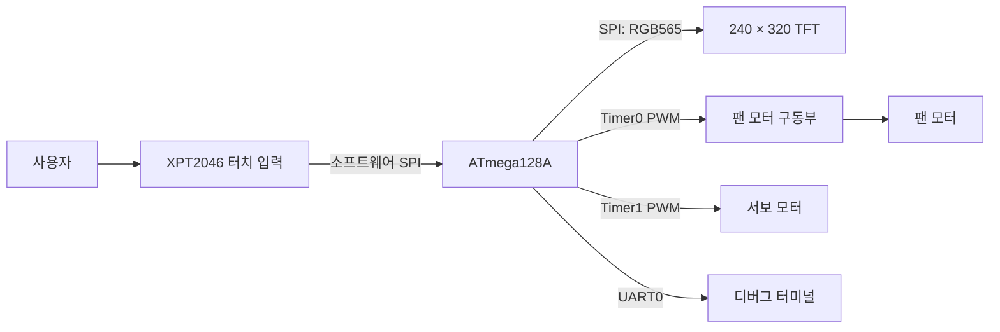
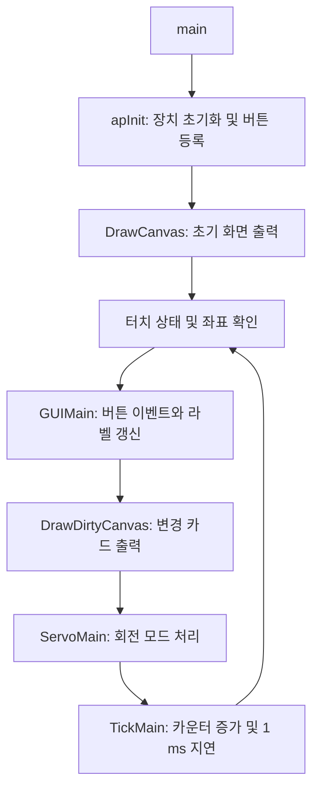

[](README_KR.md) [](README_EN.md)

# Project Fan | 터치 GUI 기반 스마트 선풍기

**ATmega128A에서 터치 입력, 팬 풍속 제어, 서보 회전, 컬러 GUI를 통합한 임베디드 시스템 프로젝트입니다.**

사용자는 240 × 320 TFT 화면의 카드를 눌러 팬 전원, 3단 풍속, 좌우 회전을 조작합니다. 펌웨어는 입력 처리와 모터 제어를 연결하고, 작은 메모리에서도 화면을 구성할 수 있도록 부분 더블 버퍼링과 변경 카드 갱신을 사용합니다.

> **문서 범위:** 이 README는 저장소의 **`Main/` 통합 펌웨어**를 설명합니다. 구현 및 검증 기준은 소스 커밋 [`fbce8fc`](https://github.com/KanghyuckMoon/Project_Fan/commit/fbce8fc136c43b9fa3c4497e87c293f829266570)이며, 자동 모드는 UI만 구현되어 있습니다. 실제 센서 기반 자동 제어와 추적 제어는 향후 확장 항목입니다.

**기술 구성:** C11 · AVR GCC · CMake · PWM · SPI · UART · RGB565 · XPT2046

## 목차

- [개발 목적](#개발-목적)
- [주요 기능과 구현 상태](#주요-기능과-구현-상태)
- [시스템 구성](#시스템-구성)
- [화면 및 조작 방법](#화면-및-조작-방법)
- [핵심 설계](#핵심-설계)
- [하드웨어 핀맵](#하드웨어-핀맵)
- [소스 구조와 검토 경로](#소스-구조와-검토-경로)
- [빌드 및 실행](#빌드-및-실행)
- [검증 결과](#검증-결과)
- [발표 시연 시나리오](#발표-시연-시나리오)
- [DebugLog 디버깅](#debuglog-디버깅)

## 개발 목적

선풍기의 기본 조작을 하나의 터치 화면에 통합하고, **입력 → 상태 변경 → PWM 출력 → 화면 피드백**으로 이어지는 제어 흐름을 구현하는 것이 목표입니다.

이 과정에서 다음 세 가지 설계 과제를 다룹니다.

| 설계 과제 | 구현 접근 |
| --- | --- |
| 여러 장치를 하나의 MCU에서 제어 | 팬과 서보에 서로 다른 타이머를 배정하고, 터치·화면·제어 로직을 모듈로 분리 |
| 조작 결과를 화면으로 전달 | 전원·회전 활성 색상, 풍속 단계와 막대 표시를 버튼 이벤트에 연결 |
| 작은 SRAM에서 컬러 GUI 구성 | 전체 프레임 대신 작은 버퍼 두 개로 띠 단위 합성, 변경된 카드만 다시 전송 |

현재 구현 범위는 **터치 기반 수동 제어와 GUI 통합**입니다. 자동·추적 기능은 확장 지점으로 구분하여 관리합니다.

## 주요 기능과 구현 상태

| 기능 | 사용자 동작과 결과 | 상태 | 확인 코드 |
| --- | --- | --- | --- |
| 팬 전원 | `POWER` 터치로 팬 ON/OFF 전환 | 구현 | [ap.c](Main/src/ap/ap.c), [fan.c](Main/src/project/fan.c) |
| 3단 풍속 | `AIRFLOW` 터치로 LEVEL 1 → 2 → 3 순환 | 구현 | [fan.c](Main/src/project/fan.c) |
| 좌우 회전 | `SWING` 터치로 서보 왕복 이동 시작/정지 | 구현 | [servo.c](Main/src/project/servo.c) |
| 터치 입력 | 좌표 변환, 눌림 확인, 길게 누를 때 중복 실행 방지 | 구현 | [touch.c](Main/src/project/touch.c), [ap.c](Main/src/ap/ap.c) |
| 카드형 GUI | 아이콘, 기능명, 활성 상태, 풍속 단계 표시 | 구현 | [GUIButton.c](Main/src/project/GUI/GUIButton.c) |
| 부분 화면 갱신 | 초기 화면 출력 후 dirty 상태인 카드만 갱신 | 구현 | [GUI.c](Main/src/project/GUI/GUI.c) |
| 자동 모드 | `AUTO MODE`의 ON/OFF 표시만 전환 | UI만 구현 | [BTN_Auto](Main/src/ap/ap.c) |
| 추적 모드 | 모드와 진입 함수 정의, 제어 분기는 비어 있음 | 확장용 구조 | [servo.c](Main/src/project/servo.c) |
| UART 디버깅 | 터치 좌표 및 서보 제어값 로그 출력 | 구현 | [debug.c](Main/src/project/debug.c), [uart0.c](Main/src/driver/uart0.c) |

## 시스템 구성



| 구성 | 역할 |
| --- | --- |
| ATmega128A | 외부 16 MHz 클록을 기준으로 입력·출력·GUI 처리 |
| 컬러 TFT | 240 × 320 해상도, RGB565 형식의 제어 화면 출력 |
| XPT2046 | 저항막 터치 입력과 12비트 원시 좌표 읽기 |
| 팬 모터 및 구동부 | PWM 입력에 따른 풍속 제어 |
| 서보 모터 | 신호 펄스 폭 변경에 따른 왕복 이동 |
| UART 연결 | 9600 bps 디버그 로그 확인 |

팬 모터는 별도 모터 구동부를 통해 연결합니다. 전원 구성, 모터 드라이버 모델, 모듈별 논리 전압은 실제 사용 부품에 맞춰 확인해야 합니다. 이 문서의 핀맵은 MCU 신호 연결을 나타냅니다.

## 화면 및 조작 방법

어두운 배경에 104 × 104 크기의 카드 네 개를 배치합니다. 전원은 민트, 회전은 파랑, 풍속은 앰버, 자동 모드는 보라색을 강조색으로 사용합니다.

```text
┌────────────────────────────┐
│ AIR / CONTROL        LOCAL │
│ SMART FAN                  │
│                            │
│  ┌──────────┐ ┌──────────┐  │
│  │  POWER   │ │  SWING   │  │
│  │  ON/OFF  │ │  ON/OFF  │  │
│  └──────────┘ └──────────┘  │
│  ┌──────────┐ ┌──────────┐  │
│  │ AIRFLOW  │ │AUTO MODE │  │
│  │ LEVEL 1–3│ │  ON/OFF  │  │
│  └──────────┘ └──────────┘  │
│      TOUCH TO CONTROL      │
└────────────────────────────┘
```

*위 그림은 화면 배치를 설명하는 개략도입니다. 실제 렌더링 결과는 아래 테스트 명령으로 PPM 파일로 출력할 수 있습니다.*

- **POWER:** 팬 전원을 전환합니다. 부팅 직후 모터 출력은 OFF입니다.
- **AIRFLOW:** 누를 때마다 풍속 단계를 순환합니다. 전원이 꺼진 상태에서도 단계를 선택할 수 있습니다.
- **SWING:** 서보의 왕복 이동을 시작하거나 갱신을 중지합니다. 팬 전원과 독립적으로 동작합니다.
- **AUTO MODE:** ON/OFF 표시만 바뀝니다. 실제 자동 제어를 수행하지 않습니다.

한 번 누른 상태에서는 이벤트가 한 번만 실행되며, 손을 뗀 뒤 다시 눌러야 다음 이벤트가 발생합니다. 카드 사이 여백은 조작 영역에 포함되지 않습니다.

## 핵심 설계

### 1. 팬과 서보의 타이머 분리

| 대상 | 타이머 및 출력 | 제어 방식 |
| --- | --- | --- |
| 팬 | Timer0 / PB4 · OC0 | 8비트 Fast PWM, `OCR0`으로 단계 지정 |
| 서보 | Timer1 / PB5 · OC1A | `ICR1=4999`, 분주비 64, 16 MHz 기준 20 ms 주기 |

팬의 단계별 비교값은 `128 / 192 / 255`입니다. 이 값은 PWM 출력 설정값이며, 실제 회전수나 풍량의 실측값을 뜻하지 않습니다.

서보는 `OCR1A`를 `250–500` 범위에서 2씩 변경하고, 끝에 도달하면 방향을 반전합니다. 16 MHz 및 분주비 64 기준으로 펄스 폭은 약 1–2 ms입니다. 실제 회전 각도는 서보와 기구부에 따라 달라집니다.

### 2. 이벤트와 표시 로직 분리

`ap.c`는 버튼의 클릭 이벤트와 라벨 갱신 함수를 등록합니다. `GUIMain()`은 터치 좌표에 해당하는 버튼을 찾아 이벤트를 실행하고, 변경된 카드를 dirty 상태로 표시합니다. `DrawDirtyCanvas()`는 해당 카드만 다시 그립니다.



### 3. SRAM 제약을 고려한 부분 더블 버퍼링

ATmega128A의 SRAM은 4,096바이트입니다. 240 × 320 RGB565 화면 전체를 저장하려면 한 장에 `240 × 320 × 2 = 153,600바이트`가 필요하므로, 내부 SRAM에 전체 프레임 버퍼를 둘 수 없습니다. 메모리 사양은 [Microchip 데이터시트](https://ww1.microchip.com/downloads/en/DeviceDoc/Atmel-8151-8-bit-AVR-ATmega128A_Datasheet.pdf)를 참고하세요.

| 항목 | 메모리 요구량 |
| --- | ---: |
| 전체 화면 버퍼 1개 | 153,600바이트 |
| 전체 화면 버퍼 2개 | 307,200바이트 |
| 현재 부분 버퍼 2개 | **1,920바이트** |

현재 구현은 480픽셀 RGB565 버퍼 두 개를 사용합니다. 화면을 작은 띠로 나누고, 배경·테두리·아이콘·글자를 합성한 뒤 완성된 띠를 TFT에 전송합니다. 전체 화면 너비에서는 2줄, 104픽셀 카드 너비에서는 4줄씩 처리합니다.

글꼴과 아이콘은 `PROGMEM`으로 플래시에 저장하고, 렌더링 버퍼는 정적으로 할당합니다. 초기 출력 이후에는 변경 카드만 갱신하여 매번 전체 화면을 전송하지 않도록 구성했습니다.

**기준 버전의 TFT 통신은 소프트웨어 SPI이며, 합성과 전송은 순차 실행됩니다.** 부분 더블 버퍼링은 화면 전체의 원자적 교체나 화면 찢어짐 방지를 보장하지 않습니다. 실제 응답 시간과 프레임 속도는 하드웨어 측정이 필요합니다. 상세 설계는 [렌더링 문서](Main/docs/rendering.md)에 정리되어 있습니다.

## 하드웨어 핀맵

| 장치 | ATmega128A 핀 | 신호 |
| --- | --- | --- |
| TFT | PB0 | CS |
| TFT | PB1 | SCK |
| TFT | PB2 | MOSI / SDI |
| TFT | PA0 | RST |
| TFT | PA1 | DC |
| 터치 | PA3 | CS |
| 터치 | PA4 | CLK |
| 터치 | PA5 | DIN, MCU → 터치 |
| 터치 | PA6 | DO, 터치 → MCU |
| 터치 | PA7 | IRQ, Active Low |
| 팬 구동부 | PB4 / OC0 | PWM 제어 |
| 서보 | PB5 / OC1A | PWM 신호 |
| UART0 | PE0 / RXD0, PE1 / TXD0 | 수신 / 송신 |

터치 보정은 [touch.h](Main/src/project/touch.h)의 `TOUCH_X_MIN/MAX`, `TOUCH_Y_MIN/MAX`에서 설정합니다. 현재 원시 입력 범위는 양 축 모두 `300–3800`이며, 화면 좌표로 변환한 뒤 방향을 반전합니다.

## 소스 구조와 검토 경로

```text
Project_Fan/
├── README.md                   # 기본 한국어 문서
├── README_KR.md                # 한국어
├── README_EN.md                # English
├── Main/                       # 이 문서의 설명 및 빌드 대상
│   ├── CMakeLists.txt
│   ├── tools/avr-toolchain.cmake
│   ├── src/
│   │   ├── main.c              # 선풍기 앱 / TFT 테스트 선택
│   │   ├── ap/                 # 초기화, 버튼 이벤트, 메인 루프
│   │   ├── project/
│   │   │   ├── fan.c           # 팬 전원과 풍속
│   │   │   ├── servo.c         # 서보 PWM과 회전 모드
│   │   │   ├── touch.c         # 터치 통신 및 좌표 변환
│   │   │   ├── tft.c           # 디스플레이 통신 및 그리기
│   │   │   ├── tick.c          # 루프 기반 시간 카운터
│   │   │   ├── debug.c         # 디버그 로그
│   │   │   └── GUI/            # Canvas, 버튼, 경계, 글꼴·색상
│   │   ├── driver/             # UART 등 공용 주변장치 드라이버
│   │   ├── common/             # 공통 정의
│   │   └── OLD/                # 이전 버튼 코드
│   ├── tests/                  # 호스트 렌더링 회귀 테스트
│   └── docs/rendering.md
├── Hwang/
├── Moon/
├── Seo/
└── lim/
```

다른 최상위 폴더는 이 README의 기능 및 검증 범위에 포함하지 않습니다. `Main/src/driver/`에는 현재 앱에서 사용하지 않는 LCD·FND 등의 공용 드라이버도 포함되어 있습니다.

코드 검토 시 **[main.c](Main/src/main.c) → [ap.c](Main/src/ap/ap.c) → [fan.c](Main/src/project/fan.c) / [servo.c](Main/src/project/servo.c) → [GUI.c](Main/src/project/GUI/GUI.c) → [tft.c](Main/src/project/tft.c)** 순서로 읽으면 입력부터 출력까지의 흐름을 따라갈 수 있습니다.

## 빌드 및 실행

### 개발 환경

- CMake 3.13 이상 및 Make 등 빌드 도구
- AVR GCC 툴체인: `avr-gcc`, `avr-g++`, AVR Binutils, AVR-LibC
- 호스트 테스트용 Python 3 및 호스트 GCC
- 대상 MCU: ATmega128A / 외부 16 MHz 클록

현재 컴파일 타깃은 `atmega128`, `F_CPU=16000000UL`, C 표준은 C11입니다. 툴체인 기본 경로는 `/opt/microchip/avr-gcc`입니다.

```bash
git clone https://github.com/KanghyuckMoon/Project_Fan.git
cd Project_Fan/Main

cmake -S . -B build -DCMAKE_TOOLCHAIN_FILE=tools/avr-toolchain.cmake
cmake --build build
```

툴체인 경로가 다르면 configure 명령에 `-DAVR_TOOLCHAIN_DIR=/your/avr-toolchain`을 추가합니다. 다른 환경의 CMake 캐시가 있다면 `-B build-local`처럼 새 빌드 폴더를 사용하세요.

| 출력 파일 | 용도 |
| --- | --- |
| `build/atmega128a.elf` | 실행 코드와 디버깅 정보 |
| `build/atmega128a.hex` | Flash 기록용 Intel HEX |
| `build/atmega128a.eep` | EEPROM 섹션 추출 결과 |
| `build/atmega128a.map` | 심볼 및 메모리 배치 확인 |

생성한 HEX는 보드와 AVR 프로그래머에 맞는 도구로 기록합니다. 현재 CMake에는 업로드 타깃이 없으며, 프로그래머 종류 및 클록 퓨즈 설정을 고정한 기록 명령도 제공하지 않습니다.

## 검증 결과

**2026-10-16, 기준 소스 `fbce8fc`의 Main 폴더를 별도 작업 디렉터리에서 빌드하고 호스트 테스트를 실행했습니다.** 검증 환경의 AVR GCC 버전은 15.1.0입니다.

| 검증 항목 | 결과 및 범위 |
| --- | --- |
| AVR 펌웨어 빌드 | 성공, ELF·HEX·EEPROM·MAP 생성 |
| 기본 화면 및 부분 렌더링 | 호스트 테스트 통과: 픽셀 일치, 중복 기록, dirty 갱신, 라벨 축소 |
| 경계와 버퍼 처리 | 호스트 테스트 통과: 클리핑, 문자 확대, 마지막 띠, 버퍼 교대, 잘못된 영역 |
| 애플리케이션 터치 흐름 | 호스트 테스트 통과: 카드 상태·풍속 표시·한 번 누름당 한 번 실행 |
| 실제 모터·터치·전기 신호 | 이 문서 작성 과정에서 보드 실측 미수행 |

빌드는 성공했으며 공용 드라이버 `fnd4.c`의 비트 연산 괄호 관련 경고 1건이 출력되었습니다.

### 메모리 사용량

| 항목 | 기준 빌드 결과 |
| --- | ---: |
| Flash 점유량 (`text + data`) | 9,026바이트 / 128 KiB, 약 6.89% |
| 정적 SRAM (`data + bss`) | 2,470바이트 / 4 KiB, 약 60.30% |
| 정적 할당 후 남은 SRAM | 1,626바이트, 스택 등에서 사용 |

수치는 위 소스와 툴체인의 결과이며 코드·컴파일러에 따라 달라질 수 있습니다. 남은 SRAM은 스택 최대 사용량이나 런타임 안정성을 측정한 값이 아닙니다.

### 테스트 재현

`Main/`에서 실행합니다.

```bash
python3 tests/run_rendering_tests.py

# 실제 렌더링 코드의 대기·동작 화면을 PPM으로 출력
python3 tests/run_rendering_tests.py --preview-dir build/preview
```

테스트는 실제 GUI 코드를 가상 AVR 레지스터와 TFT 프로토콜 디코더에 연결합니다. GPIO 기반 바이트 전송은 테스트용 구현으로 대체하며, 모터·서보 등 주변장치 함수도 테스트용 대체 함수를 사용합니다. 따라서 위 통과 결과는 실제 풍량, 서보 각도, 터치 정확도, 전기 파형을 보장하지 않습니다. 테스트 구현은 [run_rendering_tests.py](Main/tests/run_rendering_tests.py)와 [rendering_test.c](Main/tests/rendering_test.c)에서 확인할 수 있습니다.

### TFT 색상 테스트

[main.c](Main/src/main.c)의 `AP_RENDER_TEST`를 `1`로 바꾸고 빌드하면 전체 화면에 **빨강 → 초록 → 파랑 → 노랑 → 흰색 → 검정**을 반복 출력합니다. 각 프레임은 전송이 끝난 후 500 ms 유지됩니다. 기본값 `0`에서는 선풍기 앱이 실행됩니다.

## 발표 시연 시나리오

아래는 실제 보드에서 확인할 **시연 순서와 기대 동작**입니다. 보드 실측 완료 기록과는 구분합니다.

| 순서 | 조작 | 확인할 내용 |
| --- | --- | --- |
| 1 | 전원 인가 | 제어 화면 표시, 팬 출력 OFF |
| 2 | 팬 OFF 상태에서 AIRFLOW 조작 | LEVEL 1을 선택하고 다음 전원 ON에 적용되는지 확인 |
| 3 | POWER 터치 | 팬 시작 및 전원 카드 활성 표시 |
| 4 | AIRFLOW 반복 터치 | 단계 순환, 풍속 표시와 모터 출력 변화 |
| 5 | SWING ON/OFF | 왕복 이동 및 위치 갱신 중지 |
| 6 | 카드 길게 누르기 / 여백 터치 | 중복 실행 방지 및 여백에서 무반응 |
| 7 | AUTO MODE 터치 | 표시 전환 확인, 자동 제어는 향후 구현임을 설명 |
| 8 | POWER OFF 및 SWING OFF | 팬 정지와 회전 중지 각각 확인 |

시연 설명에서는 **타이머 분리**, **메모리 제약에 맞춘 렌더링**, **입력·제어·표시 모듈 분리**를 코드와 연결해 보여줄 수 있습니다.

## DebugLog 디버깅

[`DebugLog()`](Main/src/project/debug.c)는 `printf` 형식의 가변 인자를 받아 UART0(9600 bps)으로 로그를 출력하는 함수입니다. `uartInit()` 이후 사용할 수 있으며, 터치 좌표·버튼 상태 갱신·서보 PWM 비교값을 터미널에서 확인해 입력과 제어 흐름을 점검합니다.

```c
DebugLog("Touch %d %d\r\n", x, y);
DebugLog("Servo OCR: %d\r\n", servoOCR);
```

내부에서 128바이트 버퍼와 `vsnprintf()`를 사용하므로 한 번에 최대 127바이트의 문자열을 전송하며, 줄바꿈은 호출 시 직접 넣습니다. UART 송신은 대기 방식이므로 로그가 많으면 메인 루프와 서보 갱신 간격에 영향을 줄 수 있습니다.
