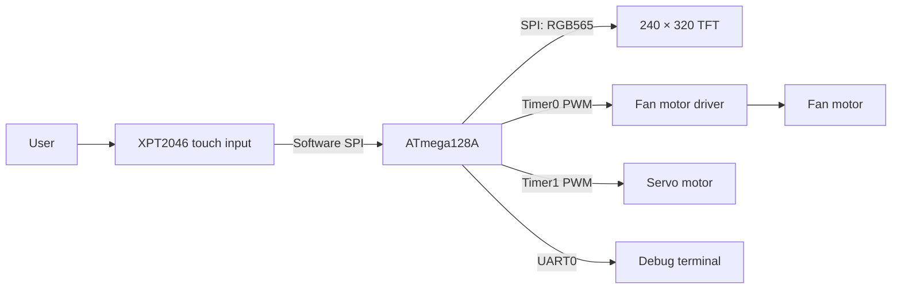
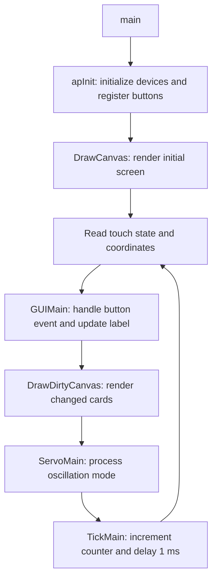

[](README_KR.md) [](README_EN.md)

# Project Fan | Touch GUI Smart Fan

**An embedded systems project that integrates touch input, fan speed control, servo oscillation, and a color GUI on an ATmega128A.**

Users control power, three airflow levels, and oscillation through cards on a 240 × 320 TFT display. The firmware connects input handling to motor control and uses partial double buffering and dirty-card updates to render the interface within a small memory budget.

> **Scope:** This README covers the integrated firmware in **`Main/`**. Implementation details and verification results refer to source commit [`fbce8fc`](https://github.com/KanghyuckMoon/Project_Fan/commit/fbce8fc136c43b9fa3c4497e87c293f829266570). Auto mode currently provides a UI toggle only. Sensor-based automatic control and tracking control are future extensions.

**Technology:** C11 · AVR GCC · CMake · PWM · SPI · UART · RGB565 · XPT2046

## Contents

- [Project Objectives](#project-objectives)
- [Features and Implementation Status](#features-and-implementation-status)
- [System Architecture](#system-architecture)
- [Interface and Controls](#interface-and-controls)
- [Key Design Decisions](#key-design-decisions)
- [Hardware Pin Map](#hardware-pin-map)
- [Source Structure and Review Guide](#source-structure-and-review-guide)
- [Build and Run](#build-and-run)
- [Verification Results](#verification-results)
- [Presentation Demo Sequence](#presentation-demo-sequence)
- [DebugLog Debugging](#debuglog-debugging)

## Project Objectives

The project brings the basic controls of a fan into one touch interface and implements the complete flow from **input → state change → PWM output → visual feedback**.

It addresses three design challenges:

| Design challenge | Implementation approach |
| --- | --- |
| Control multiple devices on one MCU | Assign separate timers to the fan and servo; separate touch, display, and control logic into modules |
| Show the result of each interaction | Connect button events to power and oscillation highlights, airflow labels, and level bars |
| Render a color GUI with limited SRAM | Compose small strips using two buffers and retransmit only changed cards |

The current implementation covers **manual touch control and GUI integration**. Automatic and tracking functions are managed as separate extension points.

## Features and Implementation Status

| Feature | User action and result | Status | Source |
| --- | --- | --- | --- |
| Fan power | Tap `POWER` to toggle the fan ON/OFF | Implemented | [ap.c](Main/src/ap/ap.c), [fan.c](Main/src/project/fan.c) |
| Three airflow levels | Tap `AIRFLOW` to cycle LEVEL 1 → 2 → 3 | Implemented | [fan.c](Main/src/project/fan.c) |
| Oscillation | Tap `SWING` to start or stop servo position updates | Implemented | [servo.c](Main/src/project/servo.c) |
| Touch input | Coordinate conversion, press detection, and one event per press | Implemented | [touch.c](Main/src/project/touch.c), [ap.c](Main/src/ap/ap.c) |
| Card GUI | Icons, titles, active states, and airflow level indicators | Implemented | [GUIButton.c](Main/src/project/GUI/GUIButton.c) |
| Partial display updates | After the initial frame, redraw only dirty cards | Implemented | [GUI.c](Main/src/project/GUI/GUI.c) |
| Auto mode | Toggle the displayed ON/OFF state of `AUTO MODE` | UI only | [BTN_Auto](Main/src/ap/ap.c) |
| Tracking mode | Mode and entry function defined; control branch is empty | Extension structure | [servo.c](Main/src/project/servo.c) |
| UART debugging | Output touch coordinates and servo control values | Implemented | [debug.c](Main/src/project/debug.c), [uart0.c](Main/src/driver/uart0.c) |

## System Architecture



| Component | Role |
| --- | --- |
| ATmega128A | Handle inputs, outputs, and GUI processing with an external 16 MHz clock |
| Color TFT | Display a 240 × 320 control interface in RGB565 format |
| XPT2046 | Read resistive touch input and 12-bit raw coordinates |
| Fan motor and driver | Control airflow through PWM input |
| Servo motor | Produce oscillation by changing the signal pulse width |
| UART connection | Monitor debug output at 9600 bps |

Connect the fan motor through a separate motor driver. Power distribution, the driver model, and module logic voltages must match the actual components. The pin map below describes MCU signal connections.

## Interface and Controls

The display uses four 104 × 104 cards on a dark background. Accent colors are mint for power, blue for oscillation, amber for airflow, and purple for auto mode.

```text
┌────────────────────────────┐
│ AIR / CONTROL        LOCAL │
│ SMART FAN                  │
│                            │
│  ┌──────────┐ ┌──────────┐  │
│  │  POWER   │ │  SWING   │  │
│  │  ON/OFF  │ │  ON/OFF  │  │
│  └──────────┘ └──────────┘  │
│  ┌──────────┐ ┌──────────┐  │
│  │ AIRFLOW  │ │AUTO MODE │  │
│  │ LEVEL 1–3│ │  ON/OFF  │  │
│  └──────────┘ └──────────┘  │
│      TOUCH TO CONTROL      │
└────────────────────────────┘
```

*This diagram illustrates the layout. The test commands below can export the actual rendered screens as PPM images.*

- **POWER:** Toggle fan power. Motor output is OFF immediately after startup.
- **AIRFLOW:** Cycle through the airflow levels. A level can also be selected while the fan is off.
- **SWING:** Start servo oscillation or stop updating its position. This control operates independently of fan power.
- **AUTO MODE:** Toggle the displayed ON/OFF state. It does not perform automatic control.

Each press triggers one event. Release and press again to trigger another event. The gaps between cards are outside the control areas.

## Key Design Decisions

### 1. Separate Timers for the Fan and Servo

| Output | Timer and pin | Control method |
| --- | --- | --- |
| Fan | Timer0 / PB4 · OC0 | 8-bit Fast PWM; level selected through `OCR0` |
| Servo | Timer1 / PB5 · OC1A | `ICR1=4999`, prescaler 64, 20 ms period at 16 MHz |

The fan comparison values are `128 / 192 / 255`. These are PWM configuration values, not measured motor speeds or airflow rates.

The servo changes `OCR1A` by 2 within the `250–500` range and reverses direction at each end. With a 16 MHz clock and a prescaler of 64, this corresponds to approximately 1–2 ms pulses. The actual angle depends on the servo and mechanical assembly.

### 2. Separate Events from Display Logic

`ap.c` registers click handlers and label update callbacks. `GUIMain()` finds the button at the touch coordinates, executes its event, and marks the changed card as dirty. `DrawDirtyCanvas()` redraws that card.



### 3. Partial Double Buffering within the SRAM Budget

The ATmega128A has 4,096 bytes of SRAM. A full 240 × 320 RGB565 frame requires `240 × 320 × 2 = 153,600 bytes`, so a full frame buffer cannot fit in internal SRAM. See the [Microchip datasheet](https://ww1.microchip.com/downloads/en/DeviceDoc/Atmel-8151-8-bit-AVR-ATmega128A_Datasheet.pdf) for memory specifications.

| Buffer configuration | Memory required |
| --- | ---: |
| One full frame buffer | 153,600 bytes |
| Two full frame buffers | 307,200 bytes |
| Two current partial buffers | **1,920 bytes** |

The implementation uses two RGB565 buffers of 480 pixels each. It divides the screen into small strips, composes backgrounds, borders, icons, and text, and sends each completed strip to the TFT. Each strip contains two rows at full screen width or four rows for a 104-pixel-wide card.

Fonts and icons are stored in flash using `PROGMEM`, and rendering buffers are statically allocated. After the initial frame, only changed cards are updated to avoid retransmitting the entire screen on every interaction.

**The reference version uses software SPI for the TFT; composition and transmission run sequentially.** Partial double buffering does not guarantee atomic full-screen replacement or tear-free output. Actual response time and frame rate require hardware measurements. See the [rendering documentation](Main/docs/rendering.md) for details; that document is in Korean.

### 4. FSM-Based Fan and Servo Control

The fan and servo use a **Finite State Machine (FSM)** approach to distinguish control states and their behavior. Touch events change power, speed, or oscillation states, and the control functions handle the corresponding PWM output.

| Device | State representation | Transitions and behavior |
| --- | --- | --- |
| Fan | `isOn` represents power; speed values `0/1/2` select LOW/MID/HIGH | `fanToggle()` changes power and `SetSpeed()` selects airflow. While OFF, the selected value is stored; while ON, the corresponding PWM comparison value is applied |
| Servo | `Mode_None`, `Mode_Rotate`, `Mode_Tracking` | `SetNoneMode()`, `SetRotateMode()`, and `SetTrackingMode()` change the state. The `switch` in `ServoMain()` executes the behavior for the current mode |

The fan represents its state through a combination of power and speed variables; the servo uses explicit mode values. `Mode_None` stops servo position updates, `Mode_Rotate` performs oscillation, and `Mode_Tracking` is an extension state whose control behavior is not yet connected.

Separating states, transitions, and output handling makes the path from button events to motor behavior easier to trace and review. See [fan.c](Main/src/project/fan.c), [servo.c](Main/src/project/servo.c), and [servo.h](Main/src/project/servo.h).

## Hardware Pin Map

| Device | ATmega128A pin | Signal |
| --- | --- | --- |
| TFT | PB0 | CS |
| TFT | PB1 | SCK |
| TFT | PB2 | MOSI / SDI |
| TFT | PA0 | RST |
| TFT | PA1 | DC |
| Touch | PA3 | CS |
| Touch | PA4 | CLK |
| Touch | PA5 | DIN, MCU → touch controller |
| Touch | PA6 | DO, touch controller → MCU |
| Touch | PA7 | IRQ, active low |
| Fan driver | PB4 / OC0 | PWM control |
| Servo | PB5 / OC1A | PWM signal |
| UART0 | PE0 / RXD0, PE1 / TXD0 | Receive / transmit |

Touch calibration is configured through `TOUCH_X_MIN/MAX` and `TOUCH_Y_MIN/MAX` in [touch.h](Main/src/project/touch.h). Both axes currently use a raw range of `300–3800`. Coordinates are mapped to the display and then inverted.

## Source Structure and Review Guide

```text
Project_Fan/
├── README.md                   # Default Korean document
├── README_KR.md                # Korean
├── README_EN.md                # English
├── Main/                       # Firmware covered by this document
│   ├── CMakeLists.txt
│   ├── tools/avr-toolchain.cmake
│   ├── src/
│   │   ├── main.c              # Select fan application or TFT test
│   │   ├── ap/                 # Initialization, events, and main loop
│   │   ├── project/
│   │   │   ├── fan.c           # Fan power and speed
│   │   │   ├── servo.c         # Servo PWM and oscillation modes
│   │   │   ├── touch.c         # Touch communication and coordinate mapping
│   │   │   ├── tft.c           # Display communication and drawing
│   │   │   ├── tick.c          # Loop-based time counter
│   │   │   ├── debug.c         # Debug logging
│   │   │   └── GUI/            # Canvas, buttons, bounds, fonts, and colors
│   │   ├── driver/             # Shared drivers including UART
│   │   ├── common/             # Common definitions
│   │   └── OLD/                # Earlier button code
│   ├── tests/                  # Host rendering regression tests
│   └── docs/rendering.md
├── Hwang/
├── Moon/
├── Seo/
└── lim/
```

Other top-level folders are outside the feature and verification scope of this README. `Main/src/driver/` also includes shared LCD and FND drivers that the current application does not use.

To follow the path from input to output, review **[main.c](Main/src/main.c) → [ap.c](Main/src/ap/ap.c) → [fan.c](Main/src/project/fan.c) / [servo.c](Main/src/project/servo.c) → [GUI.c](Main/src/project/GUI/GUI.c) → [tft.c](Main/src/project/tft.c)**.

## Build and Run

### Development Environment

- CMake 3.13 or later and a build tool such as Make
- AVR GCC toolchain: `avr-gcc`, `avr-g++`, AVR Binutils, and AVR-LibC
- Python 3 and host GCC for host tests
- Target MCU: ATmega128A with an external 16 MHz clock

The current compiler target is `atmega128`, with `F_CPU=16000000UL` and C11. The default toolchain location is `/opt/microchip/avr-gcc`.

```bash
git clone https://github.com/KanghyuckMoon/Project_Fan.git
cd Project_Fan/Main

cmake -S . -B build -DCMAKE_TOOLCHAIN_FILE=tools/avr-toolchain.cmake
cmake --build build
```

If the toolchain is installed elsewhere, add `-DAVR_TOOLCHAIN_DIR=/your/avr-toolchain` to the configure command. If an existing CMake cache belongs to another environment, use a new build directory, such as `-B build-local`.

| Output | Purpose |
| --- | --- |
| `build/atmega128a.elf` | Executable code and debugging information |
| `build/atmega128a.hex` | Intel HEX for programming flash |
| `build/atmega128a.eep` | Extracted EEPROM section |
| `build/atmega128a.map` | Symbols and memory layout |

Program the HEX using a tool appropriate for the board and AVR programmer. CMake currently has no upload target, and this project does not provide a fixed programming command for a specific programmer or clock fuse configuration.

## Verification Results

**On 2026-10-16, the Main folder from reference source `fbce8fc` was built and its host tests were run in a separate working directory.** The verification environment used AVR GCC 15.1.0.

| Check | Result and scope |
| --- | --- |
| AVR firmware build | Passed; ELF, HEX, EEPROM, and MAP files generated |
| Initial screen and partial rendering | Host tests passed: pixel matching, duplicate writes, dirty updates, and shortened labels |
| Bounds and buffer handling | Host tests passed: clipping, text scaling, final strip, buffer alternation, and invalid regions |
| Application touch flow | Host tests passed: card states, airflow display, and one action per press |
| Physical motor, touch, and electrical signals | No board measurements performed while preparing this document |

The build succeeded with one warning about bitwise-operation parentheses in the shared driver `fnd4.c`.

### Memory Usage

| Item | Reference build result |
| --- | ---: |
| Flash usage (`text + data`) | 9,026 bytes / 128 KiB, approximately 6.89% |
| Static SRAM (`data + bss`) | 2,470 bytes / 4 KiB, approximately 60.30% |
| SRAM remaining after static allocation | 1,626 bytes, available for the stack and other runtime use |

These figures depend on the source and toolchain. Remaining SRAM is not a measurement of peak stack usage or runtime stability.

### Reproduce the Tests

Run from `Main/`:

```bash
python3 tests/run_rendering_tests.py

# Export idle and active screens from the actual rendering code as PPM images
python3 tests/run_rendering_tests.py --preview-dir build/preview
```

The tests connect the production GUI code to fake AVR registers and a TFT protocol decoder. GPIO byte transmission is replaced with a test implementation, and peripheral functions such as fan and servo control use test substitutes. Passing these tests therefore does not establish physical airflow, servo angles, touch accuracy, or electrical waveforms. See [run_rendering_tests.py](Main/tests/run_rendering_tests.py) and [rendering_test.c](Main/tests/rendering_test.c).

### TFT Color Test

Set `AP_RENDER_TEST` to `1` in [main.c](Main/src/main.c) and rebuild to repeatedly display **red → green → blue → yellow → white → black** across the full screen. Each frame remains visible for 500 ms after transmission completes. The default value, `0`, runs the fan application.

## Presentation Demo Sequence

The following table lists **demonstration steps and expected behavior** to check on a physical board. It is not a record of completed board measurements.

| Step | Action | What to check |
| --- | --- | --- |
| 1 | Power on the board | Control screen appears; fan output is OFF |
| 2 | Tap AIRFLOW while the fan is OFF | Select LEVEL 1 and check that it is applied on the next power-on |
| 3 | Tap POWER | Fan starts and the power card becomes active |
| 4 | Tap AIRFLOW repeatedly | Levels cycle; display and motor output change |
| 5 | Toggle SWING ON/OFF | Servo oscillates, then position updates stop |
| 6 | Hold a card / tap a gap | No repeated event while held; no response in gaps |
| 7 | Tap AUTO MODE | Display toggles; explain that automatic control is a future extension |
| 8 | Turn POWER OFF and SWING OFF | Verify fan stop and oscillation stop separately |

During the presentation, connect the code to the decisions behind **separate timers**, **memory-aware rendering**, and **modular input, control, and display logic**.

## DebugLog Debugging

[`DebugLog()`](Main/src/project/debug.c) accepts `printf`-style variable arguments and sends formatted messages through UART0 at 9600 bps. Call it after `uartInit()` to inspect touch coordinates, button state updates, and servo PWM comparison values in a terminal.

```c
DebugLog("Touch %d %d\r\n", x, y);
DebugLog("Servo OCR: %d\r\n", servoOCR);
```

It uses a 128-byte buffer and `vsnprintf()`, transmitting at most 127 bytes per call. Add line endings explicitly. UART transmission waits for the transmitter, so heavy logging can affect the main loop and servo update intervals.
